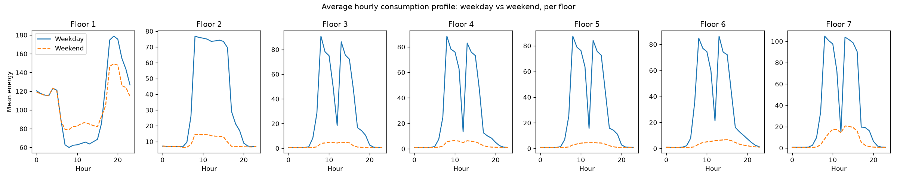
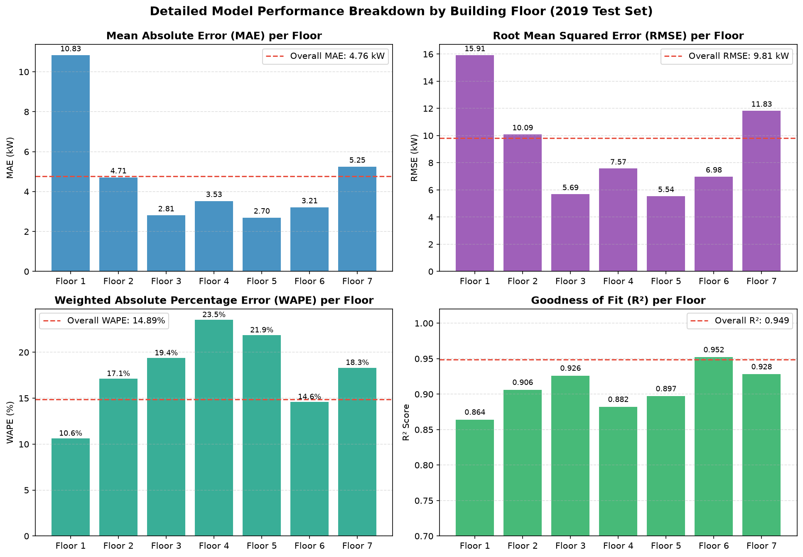
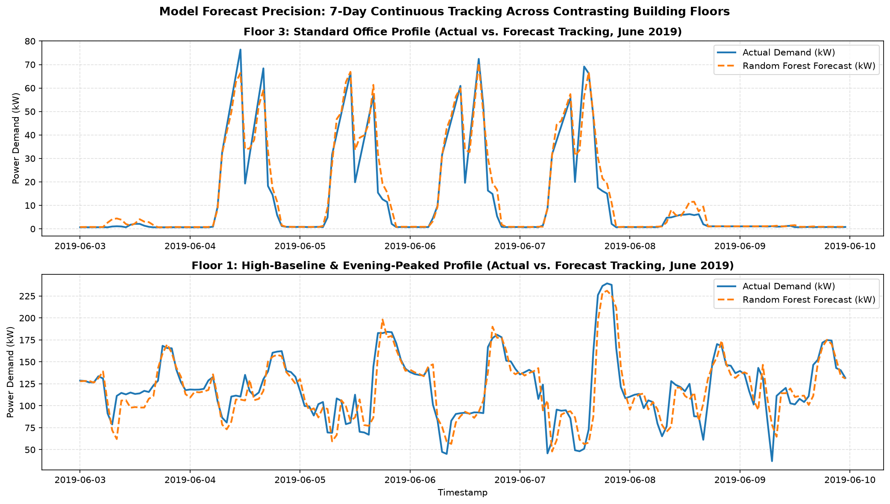
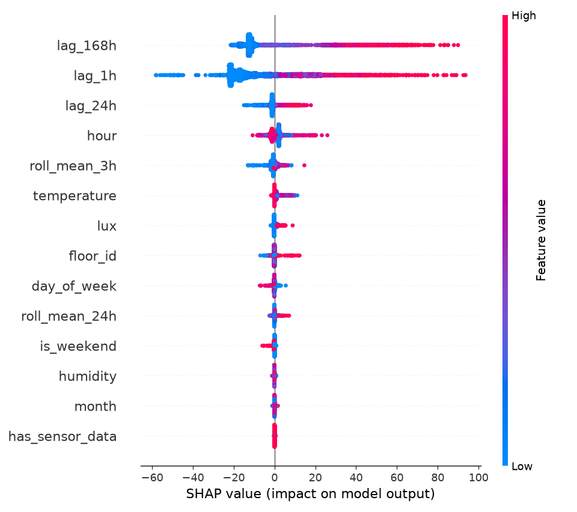

# ⚡ Smart Building Energy Consumption Prediction & Explainable AI (XAI)

[](https://www.python.org/)
[](https://streamlit.io/)
[](https://scikit-learn.org/)
[](https://shap.readthedocs.io/)
[](https://plotly.com/)
[](LICENSE)

An end-to-end machine learning system and interactive Streamlit web dashboard for hourly per-floor energy forecasting, operational scenario simulation ("What-If" analysis), and model interpretability using SHAP (Shapley Additive exPlanations). 

Trained on 18 months of smart meter and environmental sensor readings from the **CU-BEMS** (Chulalongkorn University Building Energy Management System) dataset, covering 7 distinct building floors.

---

## 📌 Executive Summary

- **High Forecast Accuracy**: Achieved an overall **$R^2$ of 0.949**, **MAE of 4.76 kW**, and **WAPE of 14.89%** on a full 1-year held-out chronological test set (2019 data) across 59,630 hourly evaluation points.
- **Explainable AI (SHAP)**: Uses TreeExplainer to deconstruct individual hourly predictions into physical and operational drivers (`lag_168h`, `lag_1h`, indoor climate, hour of day).
- **Automated Energy Optimization**: Converts SHAP attributions into actionable, plain-language demand-response recommendations for building facility managers.
- **Interactive "What-If" Engine**: Allows building managers to simulate temperature setpoint offsets (Δ°C), plug-load efficiency curtailment, and holiday/weekend operational modes in real-time.

---

## 🏗️ System Architecture

```mermaid
flowchart LR
    A["Raw CU-BEMS Data<br/>(14 CSVs, 7 Floors x 2 Yrs)"] --> B["Data Ingestion &<br/>Hourly Resampling"]
    B --> C["Data Cleaning &<br/>3xIQR Imputation"]
    C --> D["Feature Engineering<br/>(Lags, Rolling, Climate)"]
    D --> E["Chronological Split<br/>(2018 Train / 2019 Test)"]
    E --> F["Model Benchmarking<br/>(RandomForest vs. GBDT)"]
    F --> G["Model Evaluation &<br/>Stability Validation"]
    G --> H["SHAP Explainability<br/>(TreeExplainer)"]
    H --> I["Streamlit Interactive<br/>Web Application"]
```



---

## 📊 1. Exploratory Data Analysis (EDA)

The CU-BEMS dataset includes near-minute power draw across air conditioning (AC), lighting, and plug circuits, alongside indoor environmental monitoring (temperature, relative humidity, illuminance).



### Key Consumption Insights:
- **Offices (Floors 2–7)**: Strong occupancy schedules with sharp morning ramps at **07:00–08:00**, a distinct **lunchtime dip at 12:00–13:00**, an afternoon peak, and flat overnight/weekend baselines.
- **Floor 1 Anomaly**: Runs a continuous higher baseline (~106 kW vs. ~25 kW) and peaks in the **evening (18:00–20:00)** with near-identical weekday and weekend profiles (central facilities / servers).

---

## 📈 2. Model Performance & Evaluation Metrics

A single unified model was trained using chronological cross-validation: **2018 data** for training and **all 2019 data** preserved as the unseen test benchmark. Random Forest significantly outperformed Gradient Boosting ($R^2 = 0.949$ vs. $0.833$; $MAE = 4.76$ kW vs. $12.09$ kW).

### Floor-by-Floor Performance Dashboard



| Building Floor | Evaluation Hours ($n$) | MAE (kW) | RMSE (kW) | WAPE (%) | $R^2$ Score | Mean Bias |
| :---: | :---: | :---: | :---: | :---: | :---: | :---: |
| **Floor 1** | 8,760 | 10.83 | 15.91 | 10.62% | 0.864 | -1.03 kW |
| **Floor 2** | 8,760 | 4.71 | 10.09 | 17.12% | 0.906 | +0.23 kW |
| **Floor 3** | 8,760 | 2.81 | 5.69 | 19.37% | 0.926 | -1.33 kW |
| **Floor 4** | 8,760 | 3.53 | 7.57 | 23.53% | 0.882 | -1.36 kW |
| **Floor 5** | 8,760 | 2.70 | 5.54 | 21.86% | 0.897 | -1.15 kW |
| **Floor 6** | 7,070 | 3.21 | 6.98 | 14.60% | 0.952 | -0.53 kW |
| **Floor 7** | 8,760 | 5.25 | 11.83 | 18.32% | 0.928 | -0.34 kW |
| **Overall 2019 Test** | **59,630** | **4.76** | **9.81** | **14.89%** | **0.949** | **-0.78 kW** |

> **Evaluation Note**: Conventional MAPE is severely skewed by near-zero overnight baselines on office floors (dividing by ~0.05 kW). **WAPE (Weighted Absolute Percentage Error)** and **MAE** are the authoritative summary error indicators.

### 7-Day Continuous Forecast Tracking

The model accurately tracks multi-peak dynamics, midday dips, and weekend baselines across contrasting floors:



---

## 🔍 3. Explainable AI (SHAP) & Operational Insights

Using `shap.TreeExplainer`, each individual forecast is attributed back to the input features.



### Key Interpretability Takeaways:
1. **Dominance of Autoregressive Lags**: `lag_168h` (same hour one week ago) and `lag_1h` contribute over **85%** of predictive importance, confirming energy demand is heavily structured around weekly routines.
2. **Indoor AC Sensor Dynamics**: Indoor temperature exhibits a moderately negative SHAP correlation (-0.38). When chillers run hardest (high energy draw), the indoor space reads colder.
3. **Actionable Recommendations**:
   - **Target 08:00–16:00**: Pre-cooling spaces prior to 07:00 yields the largest peak demand reduction.
   - **Floor 1 Audit**: Investigate evening equipment loads rather than applying generic office daytime schedules.
   - **Avoid Over-Optimizing Weekends**: Office floors already consume minimal standby energy on weekends.

---

## 🖥️ 4. Interactive Streamlit Web Application

The interactive web dashboard ([`app.py`](app.py)) provides a suite of tools for facility managers:

- **Floor & Date Filtering**: Inspect historical actuals vs. model forecasts across any custom date range.
- **Dynamic Metrics**: Instant recalculation of MAE, RMSE, WAPE, and $R^2$ for the selected window.
- **Interactive SHAP Explainer**: An hour slider rendering instant Plotly waterfall attribution bar charts explaining specific predictions.
- **What-If Scenario Simulation**:
  - 🌡️ **Temperature Offset (Δ°C)**: Simulate setpoint adjustments (±3.0°C).
  - ⚡ **Equipment Load Scaling (%)**: Model plug-load curtailments or equipment retrofits (±30%).
  - 📅 **Operational Schedule Mode**: Simulate forced weekend/holiday low-occupancy or active weekday rules.

---

## 🚀 Quickstart & Local Installation

### Prerequisites
- Python 3.11, 3.12, or 3.13
- Git

```bash
# 1. Clone the repository
git clone https://github.com/Harsha-7781/Energy-Prediction_System.git
cd Energy-Prediction_System

# 2. Set up virtual environment
python -m venv .venv
.\.venv\Scripts\Activate.ps1   # On Linux/macOS: source .venv/bin/activate

# 3. Install dependencies
pip install -r requirements.txt

# 4. Launch the Streamlit dashboard
streamlit run app.py
```

Open [http://localhost:8501](http://localhost:8501) in your browser.

---

## ☁️ Streamlit Cloud Deployment Guide

1. Push this repository to your GitHub account.
2. Sign in to [share.streamlit.io](https://share.streamlit.io) with your GitHub account.
3. Click **"New app"** and enter:
   - **Repository**: `Harsha-7781/Energy-Prediction_System`
   - **Branch**: `main`
   - **Main file path**: `app.py`
4. Click **Deploy!**. The serialized model bundle and feature set are pre-packaged, allowing immediate deployment.

---

## 📂 Project Structure

```
Energy-Prediction_System/
├── .python-version               # Python runtime specification (3.13)
├── .gitignore                    # Production gitignore rules
├── requirements.txt              # Production Python package requirements
├── README.md                     # Project documentation & visual reports
├── app.py                        # Streamlit web application & What-If simulator
├── images/                       # Project figures & evaluation plots (all 21 archived)
├── models/
│   └── energy_model_latest.joblib # Serialized RandomForest pipeline bundle
├── Data/
│   └── processed/
│       └── features_hourly.csv    # Engineered feature dataset for Streamlit UI
├── reports/                      # Detailed technical analysis markdown reports
└── src/                          # Reusable data & ML pipeline modules
```

---

## 📜 License
This project is open-source and available under the [MIT License](LICENSE).
